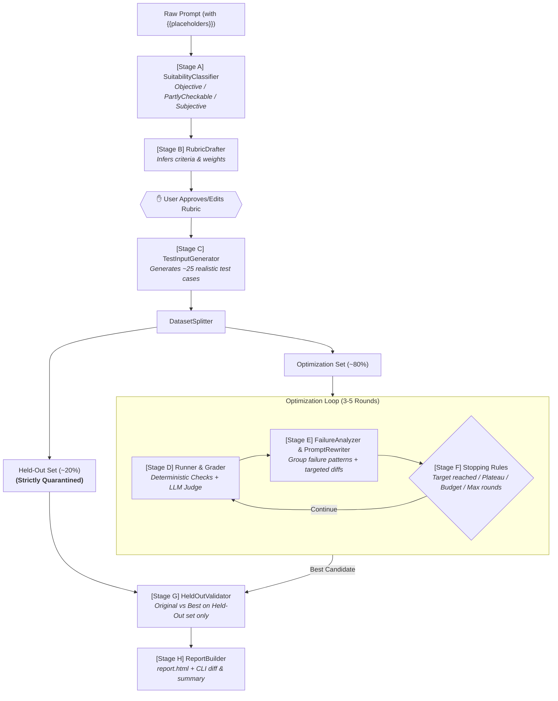

# PromptOptimizer

[](https://dotnet.microsoft.com/)
[](LICENSE)
[](https://docs.microsoft.com/dotnet/csharp/)

**PromptOptimizer** is an automated, measured, and transparent prompt optimization pipeline for Large Language Models built on .NET 10.

Prompt engineering is traditionally done "by feel" — tweaking phrases and testing a couple of inputs until an output looks right. Unfortunately, changes that fix one edge case frequently break others without warning. PromptOptimizer treats prompts as code: defining explicit rubrics, running deterministic tests, quarantining held-out validation data, and using failure patterns to drive targeted, evidence-based rewrites.

---

## Key Features

- **Explicit, Editable Rubrics**: Task requirements are parsed into deterministic (code-based) and judged (LLM-evaluated) criteria. Users inspect and approve the definition of "good" before optimization begins.
- **Deterministic Checks First**: Verifiable constraints (valid JSON, max length limits, required keywords, forbidden phrases) are evaluated in C# with zero token cost and zero judge bias.
- **Strict Held-Out Validation**: Generated test sets are split into an **Optimization set** (~80%) and a **Held-Out set** (~20%). The held-out set is strictly quarantined from the rewrite step. Overfitting is explicitly measured and reported via an **Overfit Gap** metric:
  $$\text{Overfit Gap} = \Delta\text{Optimization Score} - \Delta\text{Held-Out Score}$$
- **Evidence-Based Rewriting**: Every rewrite is driven by observed failure patterns with concrete failing examples. Rewrites produce small, targeted diffs accompanied by explicit change logs.
- **Subjectivity Guardrails**: Prompts with purely aesthetic or subjective quality criteria are flagged upfront during suitability classification.
- **Continuous Checkpointing & Resumption**: Experiment progress is persisted after every stage and optimization round. Interrupted runs resume seamlessly with `--resume`.
- **Rich Reports & CLI Output**: Generates a self-contained HTML report with side-by-side prompt diffs, per-criterion breakdowns, score trajectories, and directly outputs the best candidate and diff in the terminal.

---

## Pipeline Architecture



---

## Getting Started

### Prerequisites

- [.NET 10.0 SDK](https://dotnet.microsoft.com/download/dotnet/10.0) or later.
- API key for one of the supported LLM providers (Google Gemini, Anthropic Claude, or any OpenAI-compatible Generic REST endpoint).

### Installation & Build

Clone the repository and build the solution:

```bash
git clone https://github.com/<your-username>/PromptOptimizer.git
cd PromptOptimizer
dotnet build PromptOptimizer.slnx
```

---

## Configuration

Configure your LLM credentials either via environment variables or in `src/PromptOptimizer/appsettings.json`.

### Option A: Environment Variables (Recommended)

Set standard environment variables according to your provider:

```bash
# Google Gemini
export GEMINI_API_KEY="your-gemini-api-key"

# Anthropic Claude
export ANTHROPIC_API_KEY="your-anthropic-api-key"

# OpenAI or Generic OpenAI-compatible endpoints
export OPENAI_API_KEY="your-openai-api-key"

# Or use the PROMPTOPT_ prefix to override any appsettings key:
export PROMPTOPT_Llm__Gemini__ApiKey="your-gemini-api-key"
```

*(On Windows PowerShell, use `$env:GEMINI_API_KEY="your-gemini-api-key"`)*

### Option B: `appsettings.json`

Edit `src/PromptOptimizer/appsettings.json`:

```json
{
  "Llm": {
    "Provider": "Gemini",
    "Gemini": {
      "ApiKey": "YOUR_API_KEY_HERE",
      "BaseUrl": "https://generativelanguage.googleapis.com/v1beta/openai/",
      "ChatEndpoint": "chat/completions",
      "RunnerModel": "models/gemini-2.5-flash",
      "JudgeModel": "models/gemini-2.5-pro",
      "AnalyzerModel": "models/gemini-2.5-pro"
    },
    "Anthropic": {
      "ApiKey": "YOUR_API_KEY_HERE",
      "BaseUrl": "https://api.anthropic.com/v1",
      "RunnerModel": "claude-3-5-haiku-20241022",
      "JudgeModel": "claude-3-5-sonnet-20241022",
      "AnalyzerModel": "claude-3-5-sonnet-20241022"
    },
    "GenericRest": {
      "ApiKey": "YOUR_API_KEY_HERE",
      "BaseUrl": "https://api.openai.com/v1",
      "ChatEndpoint": "chat/completions",
      "RunnerModel": "gpt-4o-mini",
      "JudgeModel": "gpt-4o",
      "AnalyzerModel": "gpt-4o"
    }
  }
}
```

---

## CLI Usage

Run the optimization pipeline on a template prompt:

```bash
dotnet run --project src/PromptOptimizer -- optimize samples/extract-invoice.md --provider Gemini
```

### Command Options

```text
Arguments:
  <prompt-file>     Path to the prompt markdown file containing {{placeholders}}

Options:
  --provider        LLM provider: 'Gemini', 'Anthropic', 'GenericRest', or 'Mock'
  --name            Custom experiment name (defaults to timestamp-slug)
  --max-rounds      Maximum optimization rounds (default: 2)
  --budget          Maximum dollar budget cap (default: $5.00)
  --repeats         Number of runs per test case for score averaging (default: 1)
  --resume          Resume from last checkpoint if experiment exists (default: false)
  -?, -h, --help    Show help and usage information
```

### Example Starter Prompts

Starter prompts with placeholder syntax are provided in the `samples/` directory:
- `samples/extract-invoice.md`: Structured JSON invoice data extraction.
- `samples/support-classifier.md`: Multi-category customer ticket classification with confidence thresholds.

---

## Interactive Stages

1. **Suitability Check (Stage A)**: Verifies whether the prompt task is objectively checkable, partially checkable, or purely subjective.
2. **Rubric Review (Stage B)**: The pipeline drafts criteria (e.g. valid JSON, field presence, no preamble, correct types) and weights. You can inspect, edit, or approve the rubric before any test run occurs.
3. **Test Cases Review (Stage C)**: Generates ~25 realistic, boundary-testing, adversarial, and edge-case inputs across five categories. Review and confirm before splitting into optimization and quarantined held-out sets.
4. **Optimization & Iteration (Stages D–F)**: Scores outputs, groups recurring failure patterns, and prompts the rewriter for targeted fixes.
5. **Validation & Reporting (Stages G–H)**: Validates against unseen held-out inputs, computes overfit metrics, and compiles `report.html`.

---

## Experiment Artifacts

Every run creates a structured directory inside `experiments/<experiment-id>/`:

```text
experiments/<experiment-id>/
├── prompt.original.md          # Input prompt text
├── rubric.json                 # Approved evaluation rubric
├── tests.optimization.json     # Optimization test cases (~80%)
├── tests.heldout.json          # Quarantined validation cases (~20%)
├── candidates/                 # Prompt rewrites per round
│   ├── round-0.md
│   └── round-1.md
├── runs/                       # Detailed execution & grading outputs
│   ├── round-0.json
│   └── round-1.json
├── experiment.json             # Root state and metadata checkpoint
└── report.html                 # Self-contained visual HTML report
```

---

## Testing

The test suite covers deterministic checks, scoring algorithms, stopping rules, dataset splitting, and JSON parsing recovery:

```bash
dotnet test
```

---

## Project Structure

```text
prompt_eval/
├── PromptOptimizer.slnx           # .NET solution file
├── src/PromptOptimizer/           # Main application
│   ├── Evaluation/                # Checks (JSON, regex, length, phrases), Scorer, Runner, Judge
│   ├── Intake/                    # Stage A (Suitability) & Stage B (Rubric drafting)
│   ├── Llm/                       # Multi-provider client abstraction & JSON parser
│   ├── Models/                    # Strongly-typed records and domain models
│   ├── Optimization/              # FailureAnalyzer, PromptRewriter, StoppingRules, OptimizationLoop
│   ├── Reporting/                 # HTML report generation
│   ├── Storage/                   # Checkpoint serialization & filesystem store
│   ├── TestGeneration/            # Test input generation & stratified dataset splitting
│   ├── Validation/                # Stage G held-out validation
│   ├── appsettings.json           # Configuration template
│   └── Program.cs                 # CLI entry point
├── tests/PromptOptimizer.Tests/   # Unit & integration tests
├── meta-prompts/                  # System prompts for rubric, testgen, judge, rewrite
├── samples/                       # Sample candidate prompts
└── experiments/                   # Experiment output runs & HTML reports
```

---

## License

This project is licensed under the [MIT License](LICENSE).
